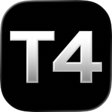

<p align="center">
  
</p>

<h1 align="center">T4 Code</h1>

<p align="center">
  A better way to control Claude Code, Codex and more from any computer or phone.
</p>

<p align="center">
  <em>An unofficial fork derived from the MIT-licensed <a href="https://github.com/pingdotgg/t3code">T3 Code</a> source code. Not affiliated with or endorsed by T3 Tools, Inc.</em>
</p>

---

## Customizations in T4 Code

Built on top of upstream `pingdotgg/t3code` with focused, rebase-friendly enhancements:

- **Unified Personal Branding & Bundle IDs**
  - Clean `T4 Code` desktop & mobile branding (no `(Beta)` suffix), bespoke geometric `T4` Apple Icon Composer assets (`prod`, `dev`, `nightly`), and unified Bundle ID `com.frameflowtech.t4code` across macOS and iOS (with `.widgets`, `.sharing`, and `group.com.frameflowtech.t4code`).
  - Shares local `~/.t3` userdata so existing projects, threads, and credentials carry over seamlessly.
- **Custom Computer / Environment Name**
  - Override each host's displayed environment name directly in **Settings → Connections** (persisted as `environmentLabel` in `settings.json`, falling back to `T3CODE_ENVIRONMENT_LABEL` / macOS `ComputerName` / hostname).
  - Automatically refreshes saved remote environment labels on reconnect when a host's name changes.
- **Sidebar Working Section at Top**
  - Configurable **Working section position** (`Top` / `Bottom`, defaulting to **Top**) so active/running threads stay prominently at the top of the sidebar, including optional top working shelf visibility when using the project-grouped (boring) sidebar.
- **Usage → Limits Custom Agent Ordering**
  - Reorder providers (e.g., Claude Code, Codex, Antigravity) directly in **Usage → Limits** with move up/down controls, persisted in local usage preferences.

## Development & Build

### Prerequisites

- Node.js + `pnpm` (`12.14.0`)
- Xcode (with Icon Composer `ictool`) for icon exports and iOS builds

### Install dependencies

```bash
pnpm install
```

### Regenerate & verify brand icons

```bash
pnpm run icons:export
pnpm run icons:export:android
pnpm run icons:check
```

### Build macOS Desktop App (`.dmg`)

```bash
pnpm run dist:desktop:dmg:arm64
```

### Build iOS App

```bash
cd apps/mobile
pnpm run ios:release
```

### Syncing with Upstream

```bash
git fetch upstream
git rebase upstream/main
```

## Attribution & License

This repository is an unofficial derivative project based on the [T3 Code](https://github.com/pingdotgg/t3code) open-source codebase. All source code remains licensed under the [MIT License](./LICENSE). All T3 Tools trademarks, logos, and official branding have been replaced with independent T4 Code assets.
